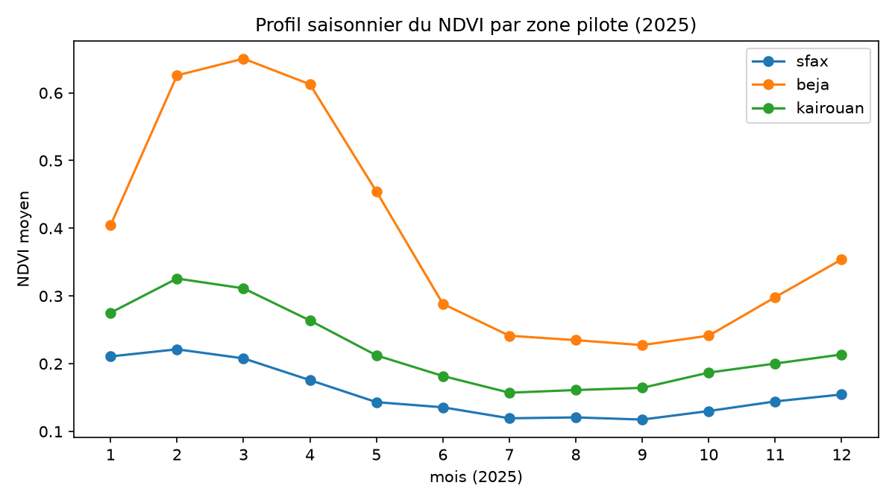
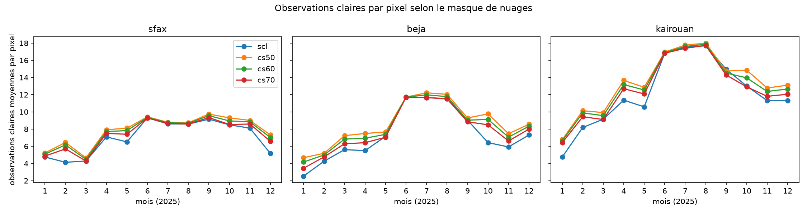

# tunisia-drought-monitoring


Suivi mensuel de l'occupation des sols et de l'état de sécheresse de la Tunisie, par gouvernorat, à partir de données satellites gratuites (ESA / Copernicus, Google Earth Engine).

> **Statut : la phase 1 (données et découpage de test) est terminée.** La classification, les indices de sécheresse, la carte interactive et l'API ne sont pas encore développés. La v1.0 vise trois gouvernorats pilotes : **Sfax** (oliviers), **Béja** (céréales) et **Kairouan** (zone mixte).

## Où en est le projet

| Étape | Résultat | Statut |
|---|---|---|
| Environnement reproductible | uv (versions verrouillées), ruff, mypy, pytest, pre-commit | ✅ |
| Accès à Google Earth Engine | projet Cloud en usage non commercial, aucune clé dans le dépôt | ✅ |
| Zones pilotes | frontières OCHA / HDX, 3 gouvernorats identifiés par leur code officiel ([ADR 0001](docs/adr/0001-source-limites-administratives.md)) | ✅ |
| Masque de nuages | SCL comparé à Cloud Score+ sur 12 mois ([ADR 0002](docs/adr/0002-masque-nuages.md)) | ✅ |
| Composites mensuels | médiane des observations claires, au moins 2 par pixel | ✅ |
| Exploration | [notebook](notebooks/01_eda.ipynb) : nuages, couverture, profils de NDVI | ✅ |
| Découpage spatial gelé | blocs de 10 km, 20 % de test, 5 folds ([ADR 0003](docs/adr/0003-decoupage-spatial-par-blocs.md)) | ✅ |
| Étiquettes (annotation QGIS) | à faire | ⏳ |
| Random Forest, U-Net | à faire | ⏳ |
| Indices de sécheresse (VCI, SMAP, SPI) | à faire | ⏳ |
| Carte interactive, API, pipeline mensuel | à faire | ⏳ |

## Premiers résultats (2025, trois zones pilotes)



- Un composite mensuel est possible toute l'année : 94 à 100 % des pixels ont au moins 2 observations claires (le minimum est à Béja en janvier).
- Béja (céréales) a un cycle net : NDVI maximal en mars (0,65), puis forte baisse d'avril à juin. Sfax (oliviers) et Kairouan (zone mixte) ont un NDVI bas et peu variable.
- En saison humide, le masque SCL conserve nettement moins d'observations que Cloud Score+ ; en été, les méthodes donnent presque le même résultat.



**Limites** : une seule année, des moyennes sur tout le gouvernorat (champs, steppe, sol nu, villes), à une résolution grossière (20 m pour les masques, 100 m pour les composites). Le choix du masque de nuages est provisoire. Rien n'est encore validé par des années sèches documentées.

## Découpage de test gelé

Pour éviter la fuite spatiale (des pixels voisins se ressemblent), le test est découpé en **blocs géographiques** de 10 km, jamais en pixels. Le découpage est enregistré une fois pour toutes dans [`configs/spatial_split.csv`](configs/spatial_split.csv), avec son empreinte SHA-256 ; des tests échouent si le fichier change.

| Zone | Blocs | Test | Entraînement |
|---|---|---|---|
| Sfax | 78 | 16 | 62 |
| Béja | 44 | 9 | 35 |
| Kairouan | 73 | 15 | 58 |

Les blocs d'entraînement sont répartis en 5 folds pour une validation croisée par blocs.

## Sources de données

| Source | Usage | Licence ou conditions |
|---|---|---|
| Sentinel-2 L2A harmonisé (ESA / Copernicus), `COPERNICUS/S2_SR_HARMONIZED` | composites mensuels | voir les conditions d'utilisation de la fiche du catalogue Earth Engine |
| Cloud Score+ (Google), `GOOGLE/CLOUD_SCORE_PLUS/V1/S2_HARMONIZED` | masque de nuages | voir la fiche du catalogue Earth Engine |
| Limites administratives (OCHA / HDX, données de l'INS Tunisie) | zones pilotes | CC BY-IGO : la source doit être citée |
| Google Earth Engine | calculs | usage non commercial |

Les données ne sont pas dans le dépôt : elles sont téléchargées ou calculées par les commandes ci-dessous.

## Reproduire

Prérequis : [uv](https://docs.astral.sh/uv/) et un compte Google Earth Engine enregistré pour un usage non commercial.

```powershell
git clone https://github.com/Hayet-belloumi/tunisia-drought-monitoring.git
cd tunisia-drought-monitoring
uv sync
uv run earthengine authenticate
$env:TDM_EE_PROJECT = "votre-projet-cloud"      # bash : export TDM_EE_PROJECT=votre-projet-cloud
uv run python -m tdm.boundaries                 # télécharge les frontières dans data/
uv run python -m tdm.zones                      # contrôle des trois zones pilotes
uv run python -m tdm.labels.split --check       # le découpage régénéré doit être identique
uv run python -m tdm.gee.explore --year 2025    # comparaison des masques de nuages
uv run python -m tdm.gee.composites --year 2025 # contrôle des composites mensuels
uv run pytest
```

## Structure du dépôt

    src/tdm/        code : gee/ (Earth Engine), labels/ (découpage), zones.py, boundaries.py
    configs/        paramètres : zones, composites, découpage spatial (et son fichier gelé)
    docs/adr/       décisions techniques justifiées
    docs/figures/   figures du notebook
    notebooks/      exploration (01_eda.py est la source, 01_eda.ipynb est généré)
    tests/          tests automatiques

## Qualité des tests

29 tests. La couverture de `src/` mesurée localement était de 36 % avant l'ajout du découpage spatial, pour une cible de 70 % : les modules qui appellent Earth Engine ne sont pas testables sans réseau. Plan : tester le téléchargement avec un faux fichier, séparer le code d'exploration du code de production, et tester la logique pure des composites. La CI n'a ni données ni accès à Earth Engine : les tests qui lisent les frontières y sont ignorés.

## Licence

Code sous licence [MIT](LICENSE). Les données restent soumises aux licences de leurs fournisseurs (voir plus haut).